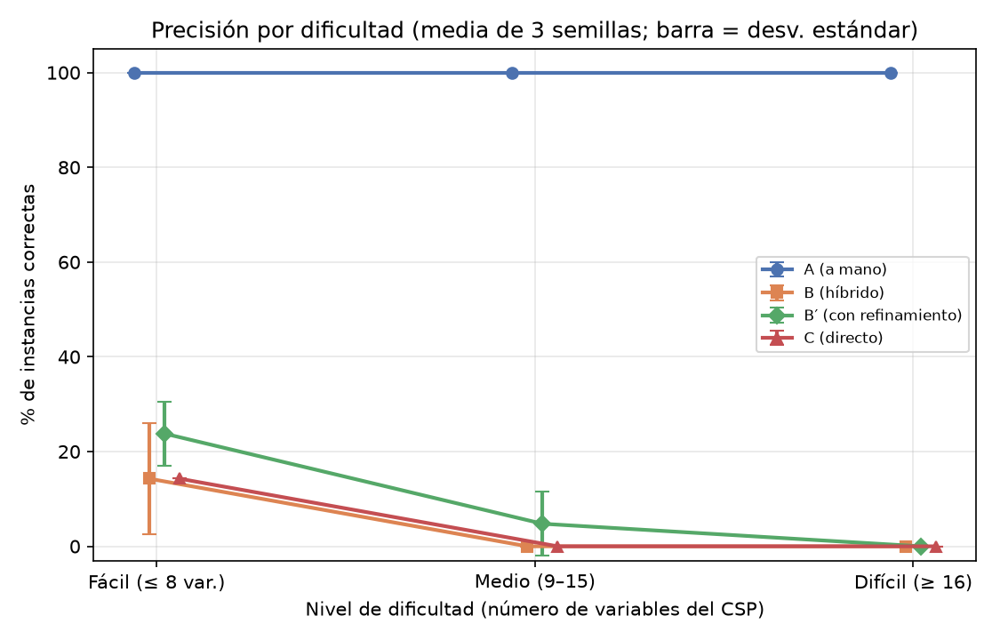
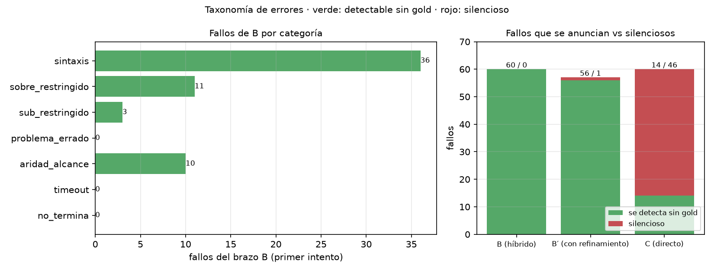
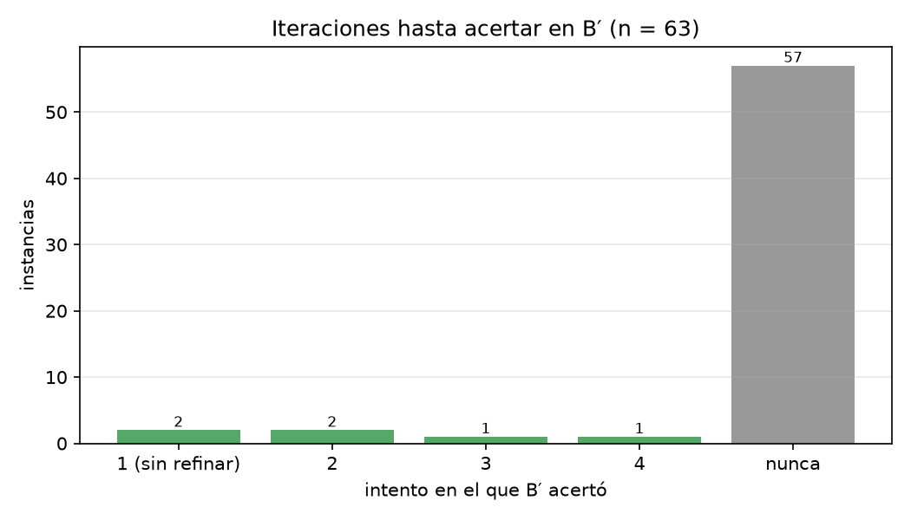
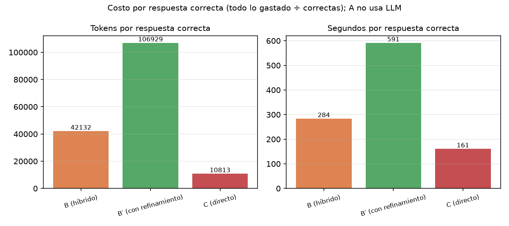

# HW2 · The Formalizer (CSP)

**Equipo:** Daniel Salazar, Andretty Ochoa, Jalil Chano · **Formalismo:** CSP con solver propio (backtracking + forward checking + MRV, que además cuenta hasta 2 soluciones) · **Modelo:** **`qwen2.5:3b`, 3 mil millones de parámetros**, en Ollama local sobre una GPU de consumo, temperatura 0.7, semillas 0, 1 y 2.

> El tamaño del modelo condiciona todos los resultados de este reporte. Con un modelo de 3B los tres brazos con LLM aciertan poco; lo interesante es **cómo** fallan.

## 0. Diseño del experimento

- **Dataset (21 problemas propios, `problems/`).** 7 por nivel, en tres familias por nivel: tipo Einstein (posiciones en fila), horarios (franjas con "inmediatamente después", "antes de") y coloreo de mapas (tres colores, vecinos distintos). La dificultad se mide por el **número de variables del CSP**: fácil ≤ 8, medio 9–15, difícil ≥ 16 (de 6 a 25 variables y de 6 a 56 restricciones). Cada problema trae su verdad base y la deducción a mano (`verificacion_manual`); además `verificar_dataset.py` comprueba que el modelo a mano tiene **solución única** e igual al gold.
- **Brazos.** A: nuestro modelo a mano → solver. B: el LLM escribe el modelo CSP en JSON → solver. B′: como B, pero si el solver reporta un error se le devuelve al LLM **solo ese mensaje** y su modelo anterior, hasta 3 veces. C: el LLM responde directo desde el enunciado.
- **Vocabulario CSP.** `alldiff`, `eq`, `neq`, `lt`, `gt`, `adj` (contiguos) y `offset` (a − b = k). Ampliamos el del studio de la semana 6, que solo tenía `alldiff`, `eq` y `neq`, para poder expresar "a la derecha de" y "junto a".
- **Instrumentación (`results/*.csv`).** Por instancia: correcto / incorrecto / sin respuesta, reloj de pared, tokens de entrada y salida, tiempo del LLM y tiempo del solver por separado, iteraciones y estado del solver. Todas las respuestas del modelo quedan en `.llm_cache/` y cada intento de B en `results/intentos_b.jsonl`.
- **Protocolo.** 21 problemas × 3 semillas = 63 instancias por brazo. Temperatura 0.7 para que las semillas midan varianza de verdad (con 0 las tres repeticiones serían idénticas). Una llamada al LLM que pasa de 300 s cuenta como fallo del modelo (`no_termina`) y no se reintenta, el mismo criterio que usamos en el deber 1.
- **El refinamiento nunca ve el gold.** `evaluar_salida` (en `brazo_b.py`) solo recibe la salida del modelo y el formato de respuesta, que es parte de la pregunta. Los mensajes que vuelven al modelo son: "no parsea (motivo)", "variable inexistente / tipo incorrecto", "no hay solución, y estas restricciones, quitadas una a la vez, lo vuelven satisfacible", "hay más de una solución; difieren en X, Y" y "timeout del solver".
- **Desarrollo de prompts, solo con los 3 problemas de ejemplo (que no cuentan).** Prompt de B v1 (formato + vocabulario + un ejemplo resuelto): 2/9 en los ejemplos. v2 (una restricción por pista con su número `"clue"`, números sin comillas, regla de dirección para "inmediatamente a la derecha/izquierda"): 3/9. Ahí lo congelamos. Para C probamos tres redacciones y elegimos la v2.

## 1. Duel Scorecard

<!-- tabla generada por code/scorecard.py -->
TABLA_SCORECARD

## 2. Precisión vs. dificultad

TEXTO_PRECISION

## 3. Taxonomía de errores

TEXTO_TAXONOMIA

### Cinco salidas verbatim del modelo, anotadas

EJEMPLOS_VERBATIM

## 4. Análisis del refinamiento (B′)

TEXTO_REFINAMIENTO

## 5. Costo por respuesta correcta

TEXTO_COSTOS

## 6. Dónde pudimos haber sido injustos

- **Tipos y sintaxis estrictos.** Nuestro parser rechaza un JSON al que le falta la llave final, y el solver rechaza `"b": "3"` (texto) cuando el dominio es numérico. Un parser tolerante habría cerrado la llave o convertido el número. Lo dejamos estricto porque así se comporta un sistema real, pero lo medimos: TEXTO_TOLERANTE
- **El vocabulario lo diseñamos nosotros.** Los 7 tipos de restricción cubren exactamente los problemas que escribimos. Un acertijo con disyunciones ("vive en la casa 1 o en la 5") no cabe, así que el dataset favorece al brazo B: las pistas se traducen casi una a una. A la vez, algunas pistas fueron redactadas de forma repetitiva ("Log is not in slot 1", "… not in slot 2", …), lo que alarga las salidas de B y le da más ocasiones de romper el JSON.
- **Ejemplo resuelto de una sola familia.** El prompt de B lleva un ejemplo tipo Einstein; horarios y coloreo no tienen uno propio, y en coloreo el modelo intentó usar `offset` sobre colores. C no lleva ejemplo resuelto: es una asimetría a favor de B.
- **Retroalimentación generosa.** B′ solo recibe información del solver, pero ese mensaje lo redactamos nosotros y es informativo (qué restricciones causan el conflicto, en qué variables difieren dos soluciones). Un solver de caja negra daría menos señal.
- **Modelo pequeño y temperatura 0.7.** Con 3B y temperatura 0.7 se equivocan todos los brazos con LLM. Elegimos 0.7 para medir varianza entre semillas; con temperatura 0 los números probablemente suban y la varianza sería cero por construcción.
- **No forzamos el modo JSON de Ollama.** Un borrador del brazo C lo usaba; lo quitamos para que C y B compitieran en igualdad. Con modo JSON ambos brazos probablemente romperían menos el formato.
- **El brazo A es 100 % por construcción:** el enunciado, el modelo a mano y el gold se escribieron juntos y el verificador exige que coincidan. Es un techo y un control de que el solver funciona, no evidencia de que modelar a mano sea fácil (el costo real de A es tiempo humano, que no medimos en tokens).
- **Los precios son un equivalente aproximado.** Together AI ya no lista modelos Qwen2.5; usamos Qwen3.5 9B, más grande que el nuestro, así que el costo en dólares está sobreestimado para los tres brazos por igual.

## 7. Recomendación

TEXTO_RECOMENDACION

**Monitoreo que adjuntaríamos:**
- Una alarma por cada instancia que el pipeline marque como sin parsear, con variable inexistente, sin solución, con varias soluciones, timeout del solver o LLM que no termina: son fallos que se anuncian solos y nunca deben llegar al usuario como respuesta.
- Revisión humana de una muestra de los modelos con solución única, porque "modelo válido del problema equivocado" es el único fallo silencioso de B.
- Seguimiento semanal de la tasa de cada categoría y de las iteraciones de B′, para detectar si cambió el modelo o el tipo de problemas que llegan.
